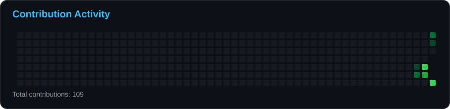

<!-- ========================================================= -->
<!--                    PROFILE BANNER                         -->
<!-- ========================================================= -->

 

# Mohamed Lamine Rahali

### Software Engineer | Java Backend Developer | AI Enthusiast

**Building reliable, scalable, and maintainable software solutions.**

 

  

  

---

## 👨‍💻 About Me

I'm a **Software Engineer specializing in Java backend development**, with approximately **3 years of professional experience** designing, developing, and maintaining enterprise applications.

My engineering approach focuses on writing clean, maintainable code, designing reliable APIs, and building scalable software architectures.

Beyond traditional backend engineering, I'm actively exploring **Artificial Intelligence, automation, and multi-agent systems**, with a particular interest in integrating intelligent capabilities into modern software applications.

- 🎓 **Education:** IT Engineering Degree — ESPRIT, 2021.
- 💼 **Experience:** Approximately 3 years in professional Java development.
- ☕ **Core Expertise:** Java 17, Spring Boot, Spring Security, Hibernate.
- 🏗️ **Engineering Focus:** Backend Development, REST APIs, Microservices.
- 🗄️ **Databases:** PostgreSQL, MySQL, Relational Database Design.
- 🤖 **Currently Exploring:** AI, Multi-Agent Systems, Intelligent Automation.
- 🌍 **Location:** Tunisia.
- 🎯 **Professional Goal:** Build impactful, scalable, and reliable software solutions.

---

## 🛠️ Technical Skills

### 💻 Programming Languages

 

### ⚙️ Backend Development

 

**Technologies & Concepts**

- Java 17
- Spring Boot
- Spring Security
- Spring Data JPA
- Hibernate ORM
- RESTful API Development
- JWT Authentication
- Microservices Architecture
- Object-Oriented Programming
- Clean Code & SOLID Principles

 

### 🗄️ Databases

 

**Database Engineering**

- Relational Database Design
- SQL Queries & Optimization
- Data Modeling
- Database Integration with Spring Data JPA

 

### 🔧 Development Tools & DevOps

 

**Tools & Practices**

- Git & GitHub
- Docker
- IntelliJ IDEA
- Visual Studio Code
- Postman
- Maven
- API Testing & Debugging
- Version Control & Collaborative Development

---

## 🏗️ Engineering Expertise

<table>
<tr>
<td width="50%" valign="top">

### ☕ Backend Engineering

- Enterprise Java Applications
- Spring Boot Development
- REST API Design
- Authentication & Authorization
- Database Integration
- Business Logic Implementation

</td>
<td width="50%" valign="top">

### 🧩 Software Architecture

- Layered Architecture
- Microservices
- Object-Oriented Design
- SOLID Principles
- Separation of Concerns
- Maintainable Codebases

</td>
</tr>

<tr>
<td width="50%" valign="top">

### 🗄️ Data & Persistence

- PostgreSQL
- MySQL
- Hibernate ORM
- Spring Data JPA
- Relational Data Modeling
- SQL Development

</td>
<td width="50%" valign="top">

### 🤖 Emerging Technologies

- Artificial Intelligence
- Multi-Agent Systems
- Intelligent Automation
- AI-Powered Applications
- Cloud Computing
- DevOps Practices

</td>
</tr>
</table>

---

## 🚀 Featured Projects

I believe that strong engineering skills are best demonstrated through practical projects, thoughtful architecture, and well-documented implementations.

This section will highlight selected projects involving **Java, Spring Boot, backend systems, and AI-powered applications**.

### 📌 Projects Coming Soon

I'm preparing selected projects for public release.

Future repositories will include:

- Clear technical documentation.
- Architecture and design decisions.
- Technology stack descriptions.
- Installation and execution instructions.
- API documentation where applicable.
- Practical examples and demonstrations.

<!--

FEATURED PROJECT TEMPLATE

### 🚀 Project Name

Brief description of the project, its purpose, and the problem it solves.

**Tech Stack:** Java 17 | Spring Boot | PostgreSQL | Docker

**Key Features:**
- Feature 1
- Feature 2
- Feature 3

[Repository](https://github.com/ghabghoub1/PROJECT_NAME)

-->

---

## 📚 Currently Exploring

I'm continuously expanding my technical knowledge and exploring technologies that complement my backend engineering experience.

| Area | Focus |
|---|---|
| 🤖 Artificial Intelligence | AI integration in software applications |
| 🧠 Multi-Agent Systems | Agent communication and orchestration |
| ☁️ Cloud Computing | Cloud-native application development |
| 🏗️ Software Architecture | Scalable and maintainable system design |
| ⚙️ DevOps | Containerization and deployment automation |
| 🔐 Cybersecurity | Secure software engineering practices |

---

## 📊 GitHub Statistics

  

Statistics are automatically generated and updated using GitHub Actions.

---

## 🔥 GitHub Contribution Streak

---

## 📈 Contribution Activity

 

Contribution activity generated through an automated GitHub Actions workflow.

---

## 💡 Engineering Philosophy

> Good software is not just about making things work. It's about building systems that remain reliable, understandable, and maintainable as they evolve.

My approach to software engineering is guided by a few principles:

- **Simplicity:** Prefer clear and understandable solutions over unnecessary complexity.
- **Maintainability:** Write code that other developers can easily understand and extend.
- **Reliability:** Design systems that behave predictably and handle failures gracefully.
- **Scalability:** Consider future growth without overengineering.
- **Continuous Learning:** Stay curious and continuously improve technical expertise.

---

## 🤝 Let's Connect

I'm always interested in connecting with fellow engineers, exchanging technical ideas, and discussing opportunities involving **backend development, software architecture, and artificial intelligence**.

  

**Open to technical discussions, collaboration, and interesting engineering opportunities.**

 

### Build. Innovate. Engineer.

