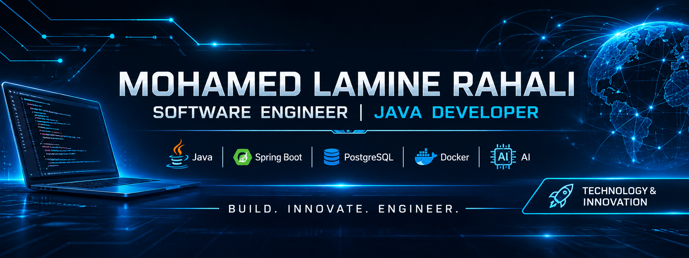
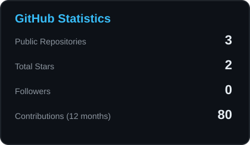
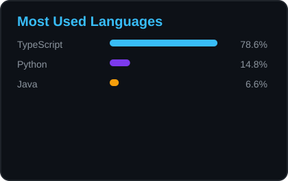

<!-- PROFILE BANNER -->

  

<!-- INTRODUCTION -->
<h1 align="center">Hi, I'm Mohamed Lamine Rahali 👋</h1>

<h3 align="center">Software Engineer | Java Developer | AI Enthusiast</h3>

  

  
  

---

## 👨‍💻 About Me

I'm an IT Engineer and Java Developer passionate about designing and building reliable, scalable and maintainable software solutions.

My primary focus is backend engineering, enterprise applications, API development and software architecture. I'm also exploring Artificial Intelligence, automation and multi-agent systems.

- 🎓 IT Engineer — ESPRIT, 2021.
- 💻 Approximately 3 years of professional Java development experience.
- ☕ Java 17 and Spring Boot.
- 🏗️ REST APIs, microservices and backend architecture.
- 🤖 Exploring AI and multi-agent architectures.
- 🗄️ PostgreSQL, MySQL and database design.
- 🌍 Based in Tunisia.
- 🚀 Interested in building technology that solves real-world problems.

---

## 🛠️ Technology Stack

### Programming Languages

  

### Backend Engineering

  

- Java 17
- Spring Boot
- Spring Security
- Spring Data JPA
- Hibernate
- RESTful APIs
- JWT Authentication
- Microservices

### Databases

  

### Tools & Infrastructure

  

### Areas of Interest

- Artificial Intelligence
- Multi-Agent Systems
- Software Architecture
- Cloud Computing
- DevOps & Automation
- Cybersecurity

---

## 🚀 Featured Projects

I believe in demonstrating engineering skills through practical projects, clean architecture and well-documented code.

Selected public projects will be showcased here as they are prepared for publication.

<!--
PROJECT TEMPLATE

### Project Name
Short description of the project.

Technologies: Java | Spring Boot | PostgreSQL | Docker

Repository: https://github.com/ghabghoub1/PROJECT_NAME

Demo: YOUR_DEMO_URL
-->

---

## 📊 GitHub Statistics

  
  

## 🔥 Contribution Streak

  

## 📈 Contribution Activity

  

---

## 🤝 Let's Connect

I'm always interested in exchanging ideas, discussing software engineering, exploring new technologies and connecting with other developers.

  
  

  <i>Build. Innovate. Engineer.</i>

